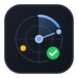
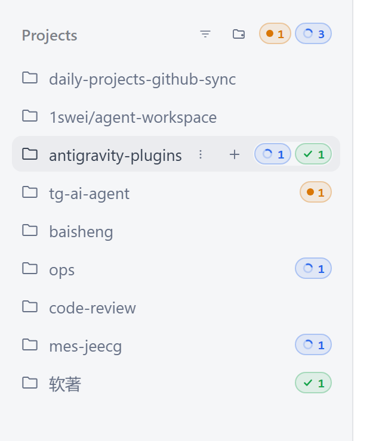
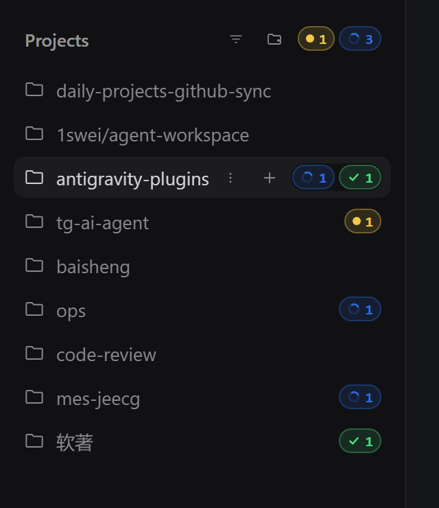
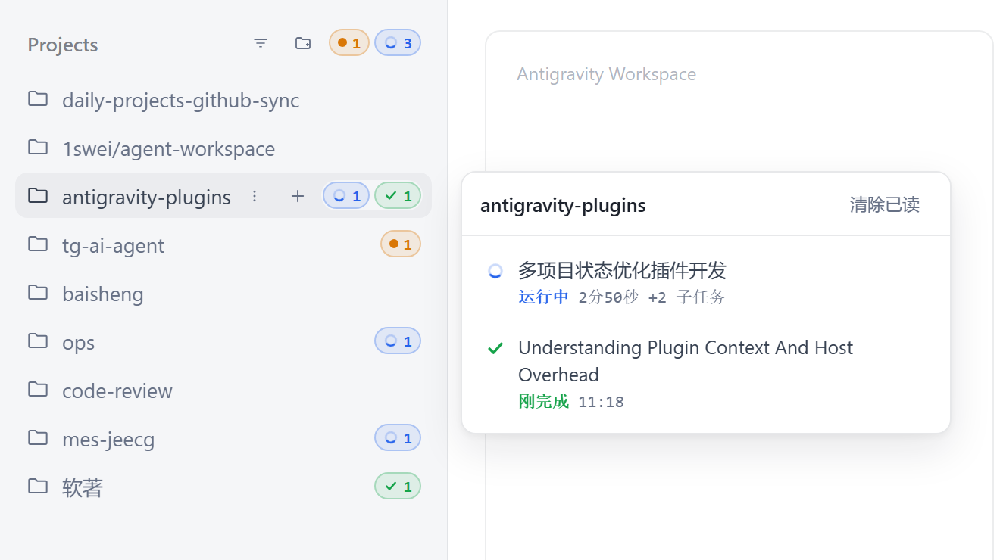
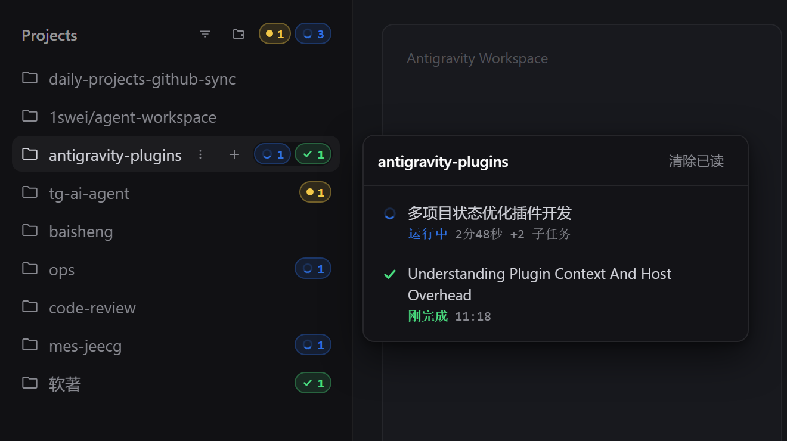
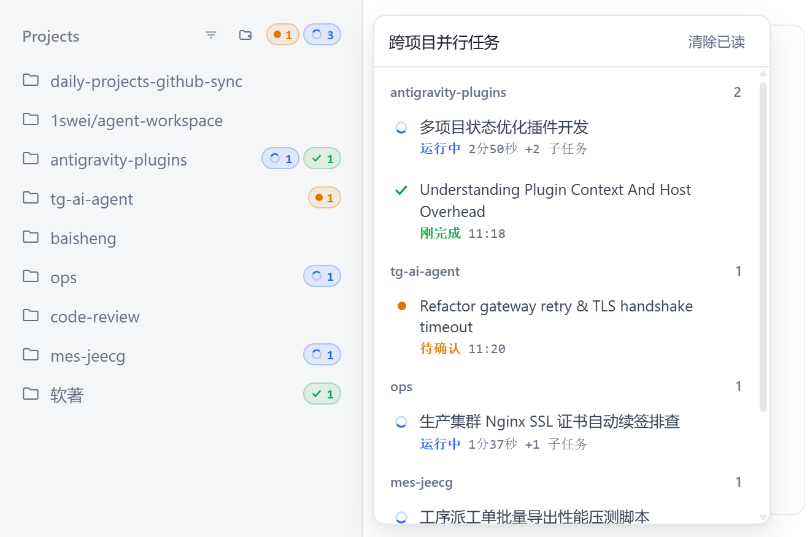
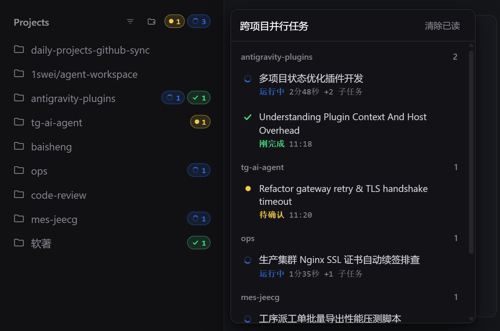

<div align="center">



# Antigravity Project Radar

[简体中文](README.md) · **English**

A lightweight standalone plugin for Antigravity 2.0 that surfaces live parallel task status (**running / waiting / unread completed**) directly on collapsed **Projects** rows, with a global summary pill and hover-to-jump popovers.

[MIT License](LICENSE) · Version `v1.0.3` · [Changelog](CHANGELOG.en.md)

</div>

---

## Preview (Light / Dark)

### 1. Stationary Right-Side Project Badges & Global Summary Pill
Status pills stay anchored to the far right edge of each Project row. Projects with no active or unread tasks stay clean; hovering a row smoothly shifts native `⋮` and `+` actions to the left of the badge without moving the badge under your cursor:

| Light Theme | Dark Theme |
| --- | --- |
|  |  |

### 2. Per-Project Task Popover
Hover or click any project badge to inspect active durations, subagent counts, and newly completed tasks without expanding the folder tree. Click any row for instant zero-reload navigation, or dismiss/clear unread completions:

| Light Theme | Dark Theme |
| --- | --- |
|  |  |

### 3. Cross-Project Global Radar Popover
Hover or click the summary pill next to **Projects** to view all active and unread-completed tasks across every project — even those scrolled out of view:

| Light Theme | Dark Theme |
| --- | --- |
|  |  |

---

## Features

- **Stationary Right-Aligned Badges**: Pinned at the far right edge of each project row; native `⋮` / `+` buttons slide left on hover (`[⋮] [+] [badge]`).
- **Zero-Reload SPA Navigation**: Reuses mounted sidebar links or invokes the host TanStack Router (`router.navigate`) directly from the React fiber tree.
- **Transition-Based Unread Tracking**: Only marks conversations as newly done (`✓`) when observed transitioning from active/waiting to settled (ignoring active view and user cancellations), with `lastUserViewTime` reverse-sync and atomic `radar-state.json` persistence.
- **Native Theme & Font Adaptation**: Inherits `document.body` font family and composited host CSS tokens (`--sidebar`, `--card`, `--card-border`, `--primary`, `--success`, `--warning`, `--error`).
- **Isolated Runtime**: Runs via dedicated CDP binding `__agRadarRuntimeCallV1` and `window.__agRadar*` namespace, coexisting cleanly alongside `antigravity-context`.

---

## Installation & Verification

Clone this repository into Antigravity's plugins directory (`antigravity-project-radar`):

```bash
git clone https://github.com/1swei/antigravity-project-radar.git ~/.gemini/config/plugins/antigravity-project-radar
```

Windows PowerShell:

```powershell
git clone https://github.com/1swei/antigravity-project-radar.git "$env:USERPROFILE\.gemini\config\plugins\antigravity-project-radar"
```

Enable **Antigravity Project Radar** under **Customizations → Plugins** (or reload the window) to activate.

Local syntax & unit tests (requires Node.js >= 20):

```bash
node --check sidecars/panel/main.mjs
node --test sidecars/panel/tests/*.test.mjs
```

Licensed under the [MIT License](LICENSE). See [Changelog (English)](CHANGELOG.en.md) · [更新日志 (中文)](CHANGELOG.md).
